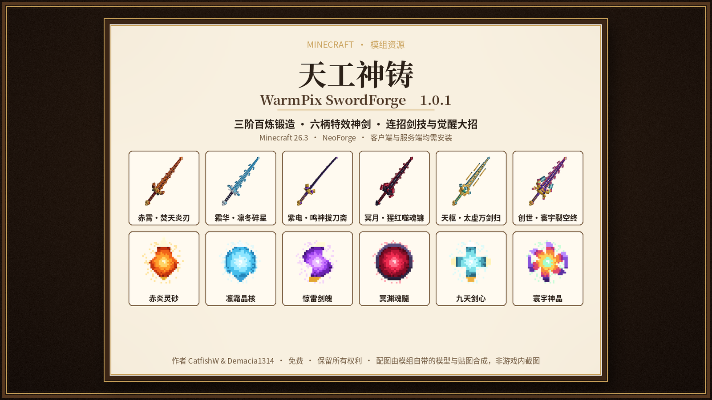
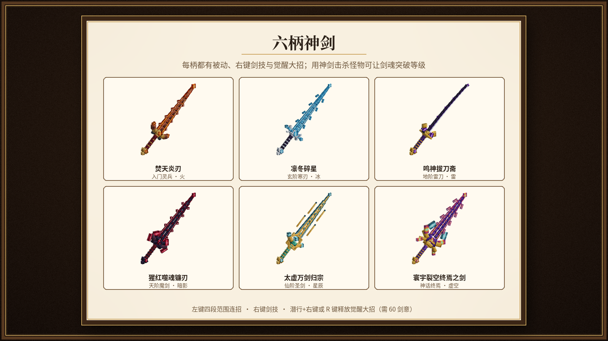
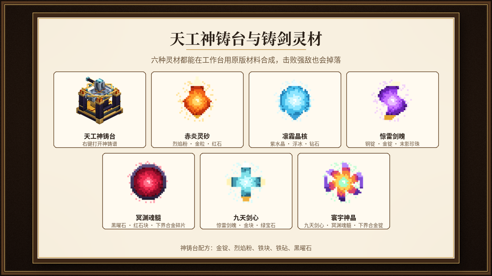
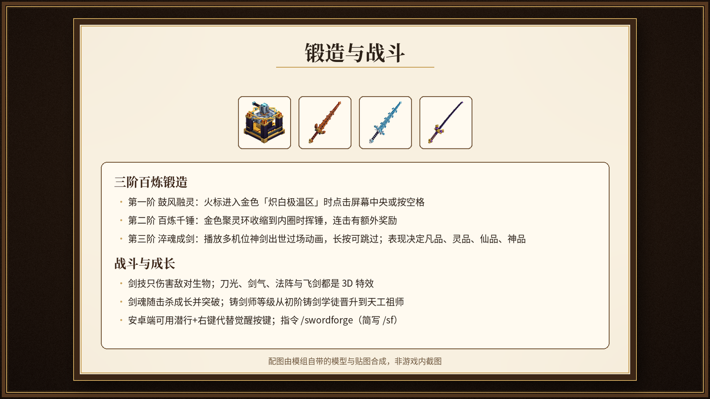

# 天工神铸 WarmPix SwordForge

在天工神铸台上玩三阶百炼锻造小游戏，铸出六柄带连招、剑技和觉醒大招的特效神剑，剑魂随战斗成长。

- Minecraft：26.3
- 加载器：NeoForge 26.3.0.23-beta 或更高
- 客户端与服务端都需要安装
- 无其他模组前置
- 语言：简体中文 / English

## 截图 Screenshots

## 下载

请到 [Releases](../../releases) 页面下载 jar（版本 1.0.1）。

## 内容

- 天工神铸台（可合成）：右键打开「天工神铸谱」，选择要锻造的神剑，查看所需灵材
- 三阶交互锻造：鼓风融灵（火标进入金色区时点击）→ 百炼千锤（聚灵环收缩到内圈时挥锤，可连击）→ 淬魂成剑，之后播放多机位神剑出世过场动画（可长按跳过）
- 锻造表现决定品阶：凡品、灵品、仙品、神品，品阶越高属性加成越高
- 六柄神剑，从入门到神话：赤霄·焚天炎刃、霜华·凛冬碎星、紫电·鸣神拔刀斋、冥月·猩红噬魂镰刃、天枢·太虚万剑归宗、创世·寰宇裂空终焉之剑，各有火、冰、雷、暗影、星辰、虚空主题
- 每柄剑都有被动、右键剑技和觉醒大招：左键四段范围连招，右键释放剑技，潜行+右键或 R 键在剑意攒满 60 后释放觉醒大招（例如召唤 36 柄飞剑倾泻、展开冰晶剑域）
- 六种铸剑灵材：赤炎灵砂、凛霜晶核、惊雷剑魄、冥渊魂髓、九天剑心、寰宇神晶，都能在工作台用原版材料合成，击败强敌也会掉落
- 剑魂成长：用神剑击杀怪物积累剑魂经验并突破等级；铸剑师等级从初阶铸剑学徒一路晋升到天工祖师
- 剑技只伤害敌对生物；高精度 3D 剑模型、刀光与法阵特效、专属音效；万象剑典快捷键可查看图鉴
- 安卓端可以用潜行+右键代替觉醒按键；指令 /swordforge（简写 /sf），管理员可发放神剑与全套灵材

## 说明

- 本仓库只用于发布 jar，不含源码。
- 服主可在 config/warmpix_swordforge/town_forge.json 指定位置，让服务器自动摆放一座神铸台（可选）。

作者：CatfishW & Demacia1314 ｜ 许可：All Rights Reserved（保留所有权利）

## 🏡 暖像素 WarmPix 服务器

本模组正在 **暖像素 WarmPix** 服务器上使用，欢迎来服里实际体验。

暖像素 WarmPix 是新开的 Java 26.3 NeoForge 模组生存服，公益服无付费内容，多线、无白名单，正版/离线账号都能进。新服招人开荒，长期稳定运营、永久不跑路。

- 服务器地址：`minecraft.warmpix.com`
- 官网：https://warmpix.com/
- 宣传片：https://www.bilibili.com/video/BV1NhWh6dEcu/
- QQ 群：**705556278**

扫码或搜索群号 705556278 加入 QQ 群。
